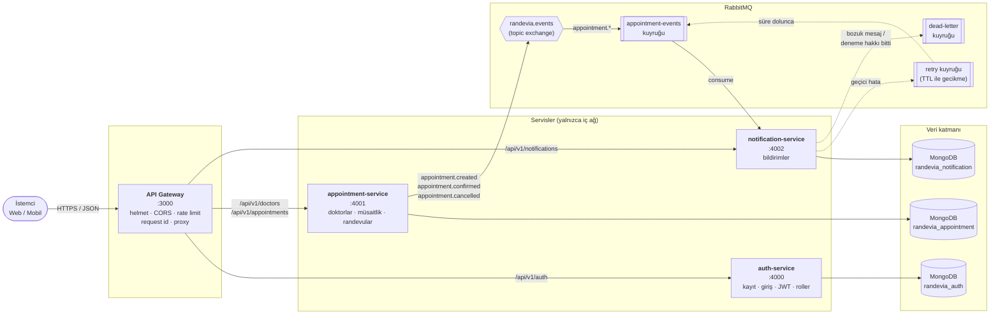
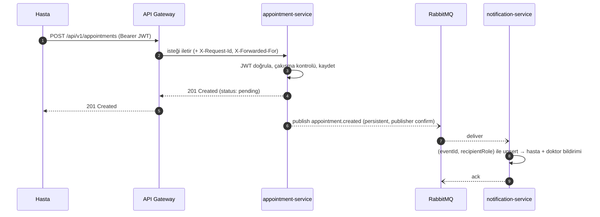

# Randevia

**Randevia**, hastaların doktorlardan randevu alabildiği, doktorların randevularını yönetebildiği ve her iki tarafın da randevu hareketlerinden otomatik olarak haberdar edildiği, **mikroservis mimarisiyle** geliştirilmiş bir sağlık randevu sistemidir.

Sistem; tek giriş noktası olan bir **API Gateway**, kendi veritabanına sahip üç bağımsız servis ve servisler arası asenkron iletişim için **RabbitMQ** üzerine kurulu olay güdümlü (event-driven) bir yapıdan oluşur. Tamamı tek komutla (`docker compose up`) ayağa kalkar.

> Geliştirici: **Mustafa Ulu**

---

## İçindekiler

- [Öne Çıkanlar](#öne-çıkanlar)
- [Mimari](#mimari)
- [Servisler](#servisler)
- [Kullanılan Teknolojiler](#kullanılan-teknolojiler)
- [Kurulum](#kurulum)
- [Yapılandırma](#yapılandırma)
- [Endpoint Listesi](#endpoint-listesi)
- [Örnek Akış](#örnek-akış)
- [Testler ve Sonuçlar](#testler-ve-sonuçlar)
- [Tasarım Kararları](#tasarım-kararları)
- [Proje Yapısı](#proje-yapısı)
- [Yol Haritası](#yol-haritası)

---

## Öne Çıkanlar

- **Tek giriş noktası:** Tüm istemci trafiği API Gateway üzerinden geçer; servisler ve veritabanları dış dünyaya kapalıdır.
- **Database-per-service:** Her servis yalnızca kendi MongoDB örneğine erişir.
- **Olay güdümlü iletişim:** Randevu olayları RabbitMQ topic exchange'i üzerinden yayınlanır, bildirim servisi bunları asenkron olarak tüketir.
- **Dayanıklı mesajlaşma:** Gecikmeli yeniden deneme (retry) kuyruğu, dead-letter queue (DLQ) ve idempotent işleme sayesinde mesajlar ne kaybolur ne de iki kez işlenir.
- **Rol tabanlı yetkilendirme:** `patient`, `doctor`, `admin` rolleri; doktor rolü yalnızca admin tarafından atanabilir.
- **Güvenlik:** JWT (access + refresh token), httpOnly refresh cookie, bcrypt ile parola özeti, helmet, CORS, rate limiting.
- **Gözlemlenebilirlik:** Her isteğe atanan `X-Request-Id` gateway'den servislere taşınır ve tüm loglarda yer alır; yapılandırılmış JSON loglar.
- **Kalite:** TypeScript strict mode, Zod ile girdi ve ortam değişkeni doğrulaması, ESLint + Prettier, 141 birim/entegrasyon testi ve 34 adımlık uçtan uca test.

---

## Mimari



**JWT doğrulaması:** Token'ları yalnızca `auth-service` üretir. Diğer servisler aynı `JWT_ACCESS_SECRET` ile token'ı kendileri doğrular; her istekte auth-service'e senkron çağrı yapılmaz. Böylece auth-service geçici olarak erişilemez olsa bile geçerli token'a sahip kullanıcılar randevu ve bildirim işlemlerine devam edebilir.

### Randevu olayının yaşam döngüsü



---

## Servisler

| Servis | Port | Sorumluluk | Veritabanı |
|---|---|---|---|
| **api-gateway** | 3000 (dışa açık) | Tek giriş noktası; yönlendirme, helmet, CORS, rate limit, request id, upstream hata yönetimi (502/504), sistem sağlık kontrolü | — |
| **auth-service** | 4000 | Kayıt, giriş, token yenileme, profil, admin kullanıcı ve rol yönetimi, ilk admin'in otomatik oluşturulması | `mongo-auth` |
| **appointment-service** | 4001 | Doktor profilleri, müsaitlik takvimi, randevu oluşturma / onaylama / iptal; randevu olaylarını yayınlama | `mongo-appointment` |
| **notification-service** | 4002 | Randevu olaylarını tüketme, hasta ve doktor için bildirim üretme ve gönderme (simüle e-posta), kullanıcının bildirimlerini listeleme | `mongo-notification` |
| **rabbitmq** | 5672 / 15672 | Mesaj aracısı; `randevia.events` topic exchange, retry ve dead-letter kuyrukları | — |

Her servis aynı iskeleti paylaşır: ortam değişkeni doğrulama (Zod), winston logger, merkezi hata yönetimi, `/api/v1/health` endpoint'i, graceful shutdown ve Jest testleri.

---

## Kullanılan Teknolojiler

| Alan | Teknoloji |
|---|---|
| Çalışma ortamı | Node.js 22, TypeScript 6 (strict) |
| Web framework | Express 5 |
| Veritabanı | MongoDB 7, Mongoose 9 |
| Mesajlaşma | RabbitMQ 3 (management), amqplib |
| API Gateway | http-proxy-middleware, helmet, cors, express-rate-limit |
| Kimlik doğrulama | JSON Web Token (jsonwebtoken), bcryptjs, cookie-parser |
| Doğrulama | Zod 4 (istek gövdesi, parametreler, query ve ortam değişkenleri) |
| Loglama | winston (JSON), morgan |
| Test | Jest 30, ts-jest, Supertest |
| Kod kalitesi | ESLint 10 (typescript-eslint), Prettier |
| Altyapı | Docker (multi-stage build), Docker Compose |

---

## Kurulum

### Gereksinimler

- [Docker](https://docs.docker.com/get-docker/) ve Docker Compose v2
- (Yalnızca yerel geliştirme ve testler için) Node.js 20+ ve npm

### Tüm sistemi Docker ile çalıştırma

```bash
git clone <repo-url> randevia
cd randevia

# (İsteğe bağlı) gizli değerleri değiştirmek için
cp .env.example .env

docker compose up -d --build
```

Tüm konteynerler sağlık kontrollerine göre sırayla başlar: önce MongoDB'ler ve RabbitMQ, ardından servisler, en son gateway.

```bash
docker compose ps                                   # hepsi "healthy" olmalı
curl http://localhost:3000/api/v1/health/services   # tüm servislerin durumu
```

| Adres | Açıklama |
|---|---|
| http://localhost:3000 | API Gateway (tüm API istekleri) |
| http://localhost:15672 | RabbitMQ yönetim paneli (`guest` / `guest`) |

Varsayılan admin hesabı: `admin@randevia.local` / `admin-password-123` (`.env` ile değiştirilebilir).

Sistemi durdurmak için `docker compose down`, verileri de silmek için `docker compose down -v`.

### Uçtan uca testi çalıştırma

Sistem ayaktayken:

```bash
node scripts/e2e.mjs
```

### Yerel geliştirme (Docker olmadan servis çalıştırma)

```bash
docker compose up -d rabbitmq                 # mesaj aracısı
docker run -d --name randevia-mongo -p 27017:27017 mongo:7

cd auth-service
cp .env.example .env
npm install
npm run dev                                   # tsx watch ile sıcak yeniden yükleme
```

Diğer servisler için de aynı adımlar geçerlidir (`appointment-service`, `notification-service`, `api-gateway`). Her serviste kullanılabilen script'ler:

| Komut | Açıklama |
|---|---|
| `npm run dev` | Geliştirme sunucusu (watch modu) |
| `npm run build` / `npm start` | TypeScript derleme / derlenmiş çıktıyı çalıştırma |
| `npm test` | Jest testleri |
| `npm run test:coverage` | Kapsam raporu ile testler |
| `npm run lint` / `npm run format:check` | ESLint / Prettier kontrolü (`src/` ve `tests/`) |

---

## Yapılandırma

Kök dizindeki [`.env.example`](.env.example) docker compose için değiştirilebilir ayarları listeler. Her servisin kendi klasöründeki `.env.example` dosyası tüm ortam değişkenlerini açıklamalarıyla birlikte içerir. Başlıcaları:

| Değişken | Varsayılan | Açıklama |
|---|---|---|
| `JWT_ACCESS_SECRET` / `JWT_REFRESH_SECRET` | geliştirme değeri | Token imzalama anahtarları (tüm servislerde aynı access secret) |
| `JWT_ACCESS_EXPIRES_IN` / `JWT_REFRESH_EXPIRES_IN` | `15m` / `7d` | Token ömürleri |
| `ADMIN_EMAIL` / `ADMIN_PASSWORD` | `admin@randevia.local` / … | Açılışta oluşturulan ilk admin |
| `CORS_ORIGIN` | `*` | `*` veya virgülle ayrılmış origin listesi (cookie yalnızca listeyle) |
| `RATE_LIMIT_MAX` / `AUTH_RATE_LIMIT_MAX` | `300` / `20` | 15 dakikada IP başına genel / giriş-kayıt-yenileme limiti |
| `PROXY_TIMEOUT_MS` | `10000` | Gateway'in servis yanıtını bekleme süresi (aşılırsa 504) |
| `MESSAGE_MAX_RETRIES` / `MESSAGE_RETRY_DELAY_MS` | `3` / `5000` | Bildirim işleme yeniden deneme sayısı ve aralığı |
| `TRUST_PROXY` | `0` (compose'da `1`) | Önündeki proxy sayısı; gerçek istemci IP'si için |
| `LOG_LEVEL` | `info` | `http` seviyesinde istek logları (request id ile) görünür |

---

## Endpoint Listesi

Tüm istekler gateway üzerinden yapılır: `http://localhost:3000`. 🔒 işaretli endpoint'ler `Authorization: Bearer <accessToken>` başlığı gerektirir.

### Sistem (api-gateway)

| Metot | Yol | Yetki | Açıklama |
|---|---|---|---|
| GET | `/api/v1/health` | — | Gateway canlılık kontrolü |
| GET | `/api/v1/health/services` | — | Tüm servislerin durumu ve gecikmesi; biri kapalıysa `503` |

### Kimlik doğrulama ve kullanıcılar (auth-service)

| Metot | Yol | Yetki | Açıklama |
|---|---|---|---|
| POST | `/api/v1/auth/register` | — | Hasta olarak kayıt olur; access token döner, refresh token cookie'ye yazılır |
| POST | `/api/v1/auth/login` | — | Giriş yapar |
| POST | `/api/v1/auth/refresh` | — | Refresh token (cookie veya gövde) ile yeni token çifti alır |
| GET | `/api/v1/auth/me` | 🔒 herkes | Oturumdaki kullanıcının profili |
| GET | `/api/v1/auth/users?role=&page=&limit=` | 🔒 admin | Kullanıcıları listeler, role göre filtreler |
| PATCH | `/api/v1/auth/users/:id/role` | 🔒 admin | Kullanıcının rolünü değiştirir (`patient` / `doctor` / `admin`) |

### Doktorlar (appointment-service)

| Metot | Yol | Yetki | Açıklama |
|---|---|---|---|
| GET | `/api/v1/doctors` | 🔒 herkes | Doktorları listeler |
| GET | `/api/v1/doctors/:id` | 🔒 herkes | Doktor detayı ve müsaitlik aralıkları |
| POST | `/api/v1/doctors/me` | 🔒 doctor | Kendi doktor profilini oluşturur / günceller (uzmanlık, biyografi) |
| POST | `/api/v1/doctors/me/availability` | 🔒 doctor | Müsaitlik aralığı ekler |

### Randevular (appointment-service)

| Metot | Yol | Yetki | Açıklama |
|---|---|---|---|
| POST | `/api/v1/appointments` | 🔒 patient | Randevu talebi oluşturur (`pending`); `appointment.created` olayı yayınlanır |
| GET | `/api/v1/appointments/me` | 🔒 patient, doctor | Kullanıcının randevuları |
| PATCH | `/api/v1/appointments/:id/confirm` | 🔒 doctor | Randevuyu onaylar; `appointment.confirmed` olayı |
| PATCH | `/api/v1/appointments/:id/cancel` | 🔒 patient | Randevuyu iptal eder; `appointment.cancelled` olayı |

### Bildirimler (notification-service)

| Metot | Yol | Yetki | Açıklama |
|---|---|---|---|
| GET | `/api/v1/notifications/me?page=&limit=` | 🔒 herkes | Kullanıcının bildirimleri, en yeniden eskiye, sayfalı |

### Yanıt formatı

Başarılı yanıtlar `{ "success": true, "data": { ... } }`, hatalar `{ "success": false, "message": "...", "details": { ... } }` biçimindedir. Gateway kaynaklı hatalar (`404`, `429`, `502`, `504`) ayrıca `requestId` alanını içerir. Her yanıtta `X-Request-Id` başlığı bulunur.

---

## Örnek Akış

```bash
GW=http://localhost:3000

# 1) Hasta kaydı
curl -s -X POST $GW/api/v1/auth/register -H 'Content-Type: application/json' \
  -d '{"name":"Ayşe Yılmaz","email":"ayse@example.com","password":"gizli-parola-123"}'

# 2) Doktor adayı önce hasta olarak kayıt olur, admin rolünü doktor yapar
ADMIN=$(curl -s -X POST $GW/api/v1/auth/login -H 'Content-Type: application/json' \
  -d '{"email":"admin@randevia.local","password":"admin-password-123"}' | jq -r .data.accessToken)
curl -s -X PATCH $GW/api/v1/auth/users/<kullaniciId>/role \
  -H "Authorization: Bearer $ADMIN" -H 'Content-Type: application/json' -d '{"role":"doctor"}'

# 3) Doktor tekrar giriş yapar, profil ve müsaitlik ekler
curl -s -X POST $GW/api/v1/doctors/me -H "Authorization: Bearer $DOKTOR" \
  -H 'Content-Type: application/json' -d '{"specialty":"Kardiyoloji"}'

# 4) Hasta randevu alır, doktor onaylar
curl -s -X POST $GW/api/v1/appointments -H "Authorization: Bearer $HASTA" \
  -H 'Content-Type: application/json' -d '{"doctorId":"<doktorProfilId>","date":"2030-01-15T10:00:00.000Z"}'
curl -s -X PATCH $GW/api/v1/appointments/<randevuId>/confirm -H "Authorization: Bearer $DOKTOR"

# 5) Her iki taraf da bildirimlerini görür
curl -s $GW/api/v1/notifications/me -H "Authorization: Bearer $HASTA"
```

Bu akışın tamamı, doğrulamalarıyla birlikte [`scripts/e2e.mjs`](scripts/e2e.mjs) içinde otomatik olarak çalıştırılır.

---

## Testler ve Sonuçlar

Her servis, gerçek MongoDB ve RabbitMQ'ya karşı çalışan entegrasyon testleri ile birim testlerine sahiptir. Gateway testleri, süreç içinde başlatılan sahte upstream servislerle çalışır.

| Servis | Test sayısı | Kapsanan başlıca senaryolar |
|---|---:|---|
| auth-service | **35** ✅ | Kayıt, giriş, refresh (cookie ve gövde), `/me`, doktor rolüyle kendi kendine kayıt reddi, admin rol atama ve listeleme, yetkisiz erişim (401/403), admin'in kendi rolünü değiştirememesi, admin bootstrap, validate middleware (Express 5 `req.query`) |
| appointment-service | **44** ✅ | Doktor profili ve müsaitlik, randevu oluşturma, çakışma (409), onay/iptal kuralları, rol kısıtları, olay yayınlama, RabbitMQ kapalıyken iş akışının sürmesi, yeniden bağlanma, validate middleware |
| notification-service | **35** ✅ | Olaydan bildirim üretimi, şablonlar, ack/nack kararları, gecikmeli retry, deneme hakkı bitince DLQ, bozuk mesajın DLQ'ya gitmesi, idempotency, sayfalama |
| api-gateway | **27** ✅ | Yönlendirme ve yol koruma, gövde/başlık/cookie aktarımı, request id üretme/taşıma/temizleme, helmet, CORS (liste, `*`, preflight, upstream başlıklarının ezilmesi), genel ve giriş limitleri (429), 502/504, sağlık kontrolleri |
| **Toplam** | **141** ✅ | |

**Uçtan uca test** (`scripts/e2e.mjs`, `docker compose up` ile ayağa kalkan gerçek sisteme karşı, yalnızca gateway üzerinden): **34/34 kontrol başarılı** ✅ — sağlık, request id, güvenlik başlıkları, rate limit başlıkları, kayıt, rol atama, doktor profili ve müsaitlik, randevu alma, çift rezervasyon engeli, onay, iptal, RabbitMQ üzerinden hasta ve doktora iletilen bildirimler, sayfalama ve kuyruk topolojisi.

Canlı sistem üzerinde ayrıca elle doğrulanan senaryolar:

- notification-service kapalıyken yayınlanan bir olay kuyrukta bekledi ve servis açıldığında işlendi (**olay kaybı yok**).
- Aynı olay ikinci kez gönderildiğinde yeni bildirim oluşmadı (**idempotency**).
- Geçersiz JSON içeren mesaj doğrudan dead-letter kuyruğuna düştü, tüketici çalışmaya devam etti.
- Gateway'e gönderilen `X-Request-Id`, hem gateway hem auth-service loglarında aynı değerle göründü; servisler gerçek istemci IP'sini gördü.

Testleri çalıştırmak için (MongoDB `localhost:27017` ve RabbitMQ `localhost:5672` erişilebilir olmalı):

```bash
cd auth-service && npm test
```

---

## Tasarım Kararları

### Database-per-service

Her servisin kendi MongoDB örneği vardır ve hiçbir servis başka bir servisin veritabanına erişmez. Bu sayede servisler bağımsız olarak geliştirilebilir, ölçeklenebilir ve dağıtılabilir; bir servisin şema değişikliği diğerlerini etkilemez, bir veritabanındaki sorun yalnızca sahibini etkiler.

Servisler arasında ihtiyaç duyulan veri, senkron sorgu yerine **JWT içeriği** (kullanıcı kimliği ve rolü) ve **olay yükü** (event payload) ile taşınır. Örneğin `appointment.created` olayı, bildirim servisinin ihtiyaç duyduğu hasta ve doktor kimliklerini ve randevu tarihini içerir; bildirim servisi randevu veritabanını sorgulamak zorunda kalmaz. Bunun bedeli, servisler arasında **nihai tutarlılık** (eventual consistency) kabul edilmesidir.

### Event-driven iletişim

Randevu oluşturma, onaylama ve iptal işlemleri `randevia.events` adlı bir **topic exchange**'e `appointment.created`, `appointment.confirmed`, `appointment.cancelled` routing key'leriyle yayınlanır. appointment-service bildirim servisinin varlığından habersizdir; yeni bir tüketici (ör. SMS veya raporlama servisi) eklemek için yalnızca yeni bir kuyruğu exchange'e bağlamak yeterlidir.

- Mesajlar **persistent** olarak ve **publisher confirm** ile gönderilir; broker mesajı diske yazdığını onaylamadan yayın başarılı sayılmaz.
- Kuyruklar **durable**'dır; tüketici kapalıyken gelen olaylar kuyrukta bekler.
- Yayınlama "best-effort"tur: RabbitMQ erişilemezse randevu işlemi yine başarılı olur, olay loglanır ve bağlantı üstel geri çekilme (exponential backoff + jitter) ile yeniden kurulur. Bu boşluğu tamamen kapatmak için outbox pattern [yol haritasındadır](#yol-haritası).

### Dead-letter queue ve yeniden deneme

Bildirim servisi her mesaj için açık bir ack/nack kararı verir:

| Durum | Karar |
|---|---|
| Başarıyla işlendi | `ack` |
| Bozuk mesaj (geçersiz JSON veya şemaya uymuyor) | `nack(requeue=false)` → doğrudan **DLQ** (tekrar denemenin anlamı yok) |
| Geçici hata, deneme hakkı var | Mesaj `x-retry-count + 1` başlığıyla **retry kuyruğuna** kopyalanır, orijinal `ack`'lenir |
| Geçici hata, deneme hakkı bitti | `nack(requeue=false)` → **DLQ** |

Retry kuyruğunun tüketicisi yoktur; mesaja verilen TTL (`MESSAGE_RETRY_DELAY_MS`) dolunca RabbitMQ mesajı dead-letter mekanizmasıyla ana kuyruğa geri gönderir. Böylece uygulama içinde zamanlayıcı tutmadan **gecikmeli yeniden deneme** elde edilir. İşleme hatalarında hiçbir zaman `requeue=true` kullanılmaz; bu, hatalı bir mesajın kuyrukta sonsuz döngüye girmesini (poison message) engeller. DLQ'daki mesajlar incelenip gerekirse elle yeniden kuyruğa alınabilir.

### Idempotency

RabbitMQ **en az bir kez** (at-least-once) teslim garantisi verir: bağlantı koptuğunda veya servis ack göndermeden çöktüğünde aynı mesaj yeniden teslim edilir. Bu nedenle bildirim işleme idempotent tasarlanmıştır:

- Her olayın benzersiz bir `eventId`'si (UUID) vardır.
- Bildirimler `(eventId, recipientRole)` üzerinde **benzersiz indeks** ile `upsert` edilir; aynı olay kaç kez gelirse gelsin hasta ve doktor için en fazla birer kayıt oluşur.
- Yalnızca `pending` durumundaki bildirimler gönderilir ve ardından `sent` olarak işaretlenir. Gönderim yarıda kalırsa yeniden teslimde iş kaldığı yerden tamamlanır, gönderilmiş bildirim tekrar gönderilmez.

### API Gateway

İstemciler servislerin adreslerini bilmez; tek bir adresle konuşur. Ortak kaygılar (güvenlik başlıkları, CORS, rate limiting, request id, upstream hata yönetimi) tek bir yerde çözülür:

- İstek gövdeleri ayrıştırılmadan **stream** edilir; yollar değiştirilmeden iletilir.
- CORS kararı yalnızca gateway'de verilir, servislerden gelen CORS başlıkları temizlenir.
- `X-Forwarded-For` eklenir, servisler `TRUST_PROXY=1` ile gerçek istemci IP'sini görür; aksi halde servislerin kendi rate limiter'ları tüm kullanıcıları tek bir IP gibi sayardı.
- Giriş, kayıt ve token yenileme için daha sıkı bir limit uygulanarak kaba kuvvet saldırıları zorlaştırılır.
- Erişilemeyen servis için `502`, zaman aşımında `504` JSON yanıtı döner.

### Yetkilendirme ve rol yönetimi

Herkes yalnızca **hasta** olarak kayıt olabilir; `role: "doctor"` ile kayıt isteği `400` ile reddedilir. Doktor (ve admin) rolü yalnızca admin tarafından `PATCH /api/v1/auth/users/:id/role` ile atanır. İlk admin, açılışta `ADMIN_EMAIL` / `ADMIN_PASSWORD` değişkenlerinden oluşturulur. Admin'in kendi rolünü değiştirmesi engellenmiştir (sistemin admin'siz kalmaması için). Yeni rol, kullanıcının bir sonraki access token'ında geçerli olur (en geç `JWT_ACCESS_EXPIRES_IN` sonra, `/refresh` ile hemen).

### Diğer kararlar

- **Graceful shutdown:** `SIGTERM` alındığında HTTP sunucusu yeni istek almayı bırakır, bildirim servisi önce tüketiciyi iptal edip işlenmekte olan mesajları bitirir, ardından RabbitMQ ve MongoDB bağlantıları kapatılır. Docker imajlarında `node` doğrudan ana süreçtir, böylece sinyal kaybolmaz.
- **Güvenli imajlar:** Multi-stage build ile çalışma imajında yalnızca üretim bağımlılıkları ve derlenmiş kod bulunur; konteynerler root olmayan `node` kullanıcısıyla çalışır.
- **Fail-fast yapılandırma:** Tüm ortam değişkenleri açılışta Zod ile doğrulanır; eksik veya hatalı yapılandırmada servis hiç başlamaz.

---

## Proje Yapısı

```
randevia/
├── api-gateway/            # Tek giriş noktası (port 3000)
├── auth-service/           # Kimlik doğrulama ve roller (port 4000)
├── appointment-service/    # Doktorlar ve randevular (port 4001)
├── notification-service/   # Bildirimler (port 4002)
├── scripts/
│   └── e2e.mjs             # Uçtan uca test
├── docker-compose.yml      # Tüm sistem: 4 servis + 3 MongoDB + RabbitMQ
└── .env.example            # docker compose ayarları
```

Her servis aynı katmanlı yapıyı izler:

```
<servis>/
├── src/
│   ├── config/         # ortam değişkenleri (Zod), veritabanı bağlantısı
│   ├── controllers/    # HTTP katmanı
│   ├── services/       # iş kuralları
│   ├── models/         # Mongoose şemaları
│   ├── routes/         # Express router'ları
│   ├── middlewares/    # authenticate, authorize, validate, hata yönetimi
│   ├── validations/    # Zod istek şemaları
│   ├── messaging/      # RabbitMQ bağlantısı, publisher / consumer
│   ├── events/         # olay sözleşmeleri
│   ├── app.ts          # Express uygulaması
│   └── server.ts       # açılış ve graceful shutdown
├── tests/              # unit/ ve integration/
├── Dockerfile
└── package.json
```

---

## Yol Haritası

- **Outbox pattern:** Olayın randevu kaydıyla aynı veritabanı işleminde bir outbox koleksiyonuna yazılıp ayrı bir süreçle yayınlanması; RabbitMQ kapalıyken bile olay kaybını tamamen önler.
- Gerçek e-posta / SMS sağlayıcı entegrasyonu (şu an gönderim simüle edilip loglanıyor).
- Refresh token rotasyonu ve iptali (logout, token blacklist).
- Dağıtık rate limiting için gateway'de Redis store.
- OpenAPI / Swagger dokümantasyonu.
- CI pipeline (GitHub Actions) ile lint, test ve imaj build.

---

## Geliştirici

**Mustafa Ulu**
